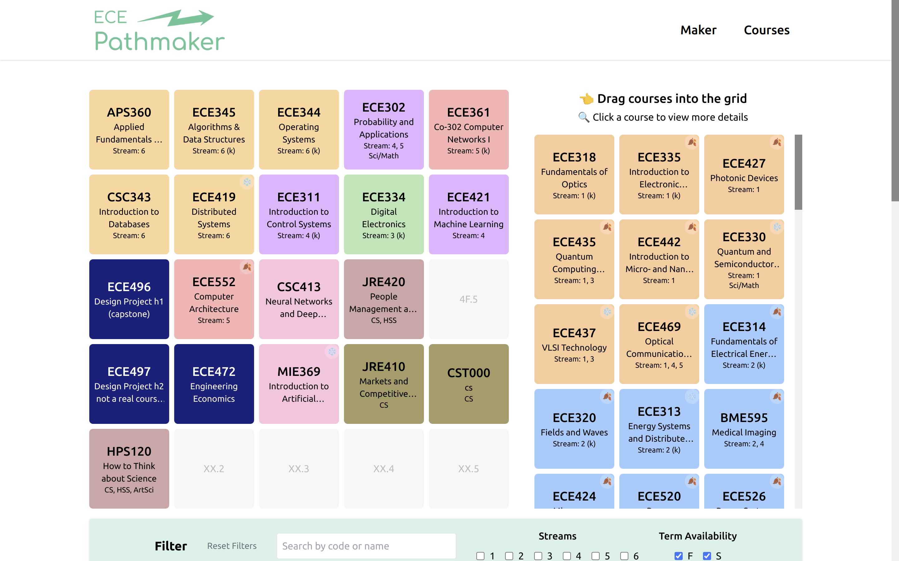

# ECE Pathmaker

ECE Pathmaker is a visual drag-and-drop course planner for UofT electrical and computer engineering students. As an unofficial companion tool to UofT ECE's Magellan, it simplifies the planning process before finalizing your pre-registration.

🌐 View the site! [**ecepathmaker.com**](https://ecepathmaker.com)

🎥 Video explanation & demo: [**sunnywu.dev**](https://sunnywu.dev) / [**67s YouTube video**](https://www.youtube.com/shorts/0KyNmwPmiMw)



## What's New

### ✨ AI Planner

Not sure where to start? The new **AI Planner** tab (`/plan`) builds a plan with any AI chat (ChatGPT, Claude, Gemini, ...), no account or API key needed:

1. **Fill in a short form**: your curriculum, the groups or areas you like, your interests, workload, courses you took before third year, courses you must take or want to avoid, and anything else (minors, PEY, ...).
2. **Copy the generated prompt** into your AI chat. It's built from the site's own course list and graduation rules, so it never goes stale.
3. **Paste the AI's reply back.** The plan loads straight onto the Maker grid, where the usual requirement and prerequisite checks verify it.
4. **Fix problems in one click.** The site flags wrong terms, missing prerequisites, unmet requirements and plans under 20 courses, and copies them back for the AI to fix.

### 🔎 Course Explorer

The Courses tab is now the **Course Explorer**: think ECE Iris, but easier to read and tied to your own plan. Instead of a giant web of crossing lines, you pick a course and see just its part of the map.

- **Focused prerequisite graph**: left to right, what the course needs (and what those need), the course itself, then what it unlocks two levels down. Click any course in the graph to jump to it.
- **Knows your plan**: every course shows where it stands for *your* grid: "In 3F on your grid", "Can take from 4F", "Missing prerequisites" or "Already taken". It uses the same rules as the Maker, so the two always agree.
- **Add to Grid** right from the course page: it picks the earliest valid term (or lets you choose another) and can overload into the sixth column.
- **Search and filter** the full list, including your custom courses, and follow the curriculum you picked.
- **Shareable links**: the selected course is in the URL (e.g. `/courses?c=ECE302`)

### 🎓 New curriculum support

Plan for either curriculum with the **curriculum picker**:

- **Before Fall 2026**: the six-area system (kernels, breadth and depth).
- **Fall 2026+**: Electrical or Computer, with groups A, B and C.

The graduation check is now a data-driven requirements engine, so each curriculum is its own rule set.

### Other Fall 2026 updates

- **Overloading and extra courses**: an optional sixth column for 6-course terms, and an EXT toggle for courses that don't count toward the degree. The XX row (courses before third year) now sits at the top.
- **Course list updates reach existing users** automatically, without resetting your layout.
- **Count-once rules (pre-2026)**: each course counts toward only one requirement, matching the calendar.
- **Smoother UI**: modern styling, a redesigned FAQ, and more

## Tech Stack

The project is built using the following technologies:
- **Frontend**: React, TypeScript, HTML, Tailwind CSS, dnd-kit (drag-and-drop), shadcn/ui (tooltip buttons), React Router
- **Auth & storage**: Firebase (Google sign-in, Firestore), `localStorage`
- **Testing**: Jest, manual testing
- **Build Tools**: Vite, PostCSS
- **Version Control**: Git, GitHub
- **CI/CD**: Hosted with continuous integration and deployment on Vercel

## Feedback

I value your feedback! Please provide your feedback [here](https://forms.gle/YjY4d6zPToQ9c2Ea6).  
NOTE: `**` was used a separation character initially, but replaced it with `%%` to avoid causing bold text when sending on messaging platforms.

## Getting Started

To get started with the project, follow these steps:

1. Clone the repository
2. Install dependencies: `npm install`
3. Start the development server: `npm run dev`

## Contributing

Contributions are welcome! Please fork the repository and submit a pull request.

When you change `mockCourses.ts`, add an entry to `src/data/courseUpdates.ts` so existing users receive it.

## Future Work

- [x] Proper mobile experience
- [x] Add more courses and course information in database (all courses in Magellan)
- [x] Use `localStorage` to store data in the browser
- [x] Clear grid button
- [x] Screenshot button
- [x] Easier way to edit colors
- [x] Support for co-requisites
- [x] Dark mode
- [x] Multiple saved layouts
- [x] Google OAuth login (Firebase)
- [x] Curriculum picker (six-area option for before Fall 2026, Electrical or Computer for Fall 2026+)
- [x] 6th column for overloading (in a different color), and extra (EXT) courses
- [x] Course explorer with prerequisite graph
- [x] AI Planner: generate a prompt for any AI chat and load its plan onto the grid
- [ ] Proper backend to store core course details and improve save/load functionality
- [ ] Store data in the URL
- [ ] Checking for minors and certificates (much hardcoding)
- [ ] Extend to other engineering disciplines

## Example

Try this layout! ECE graduation, AI minor, business certificate (screenshot above):

```plaintext
APS360Applied Fundamentals of Deep Learning%%6#ffd699$$ECE345Algorithms & Data Structures%%6k#ffd699$$ECE344Operating Systems%%6k#ffd699$$ECE302Probability and Applications%%45m#e6b3ff$$ECE361Co-302 Computer Networks I%%5k#ffb3b3@@CSC343Introduction to Databases%%6#ffd699pESC190|ECE345$$ECE419Distributed Systems%%6s#ffd699pECE344|ECE353$$ECE311Introduction to Control Systems%%4k#e6b3ff$$ECE334Digital Electronics%%3k#b3e6b3$$ECE421Introduction to Machine Learning%%4#e6b3ffpSTA286|ECE302@@ECE496Design Project h1 (capstone)%%#091f7d$$ECE552Computer Architecture%%5f#ffb3b3$$CSC413Neural Networks and Deep Learning%%#ffc2e0pCSC311|CSC411|STA314|ECE421|ROB313$$JRE420People Management and Organizational Behaviour%%h#d4a5a5$$@@ECE497Design Project h2 not a real course (capstone)%%#091f7d$$ECE472Engineering Economics%%#091f7d$$MIE369Introduction to Artificial Intelligence%%s#ffc2e0pMIE236|ECE286|ECE302$$JRE410Markets and Competitive Strategy%%c#a89c64$$CST000cs%%c#a89c64@@HPS120How to Think about Science%%ha#d4a5a5$$
```